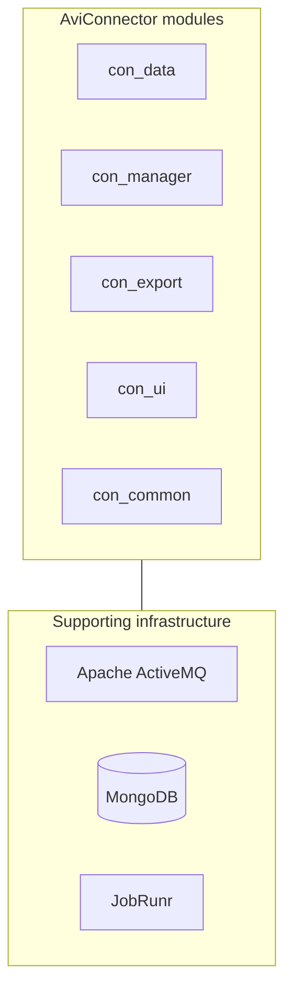

# AviConnector

**A modular Java and Spring Boot platform for asynchronous data integration, processing, and service coordination.**


[](https://github.com/AliBigdeli0/AviConnector/actions/workflows/ci.yml)

## Overview

AviConnector is a multi-module software system developed as part of the AVI project. It provides a foundation for integrating data sources, processing incoming messages, persisting data, and coordinating background operations.

The project separates data processing, management, export, user interface, and shared functionality into dedicated modules. This separation supports maintainability and allows individual components to be built independently.

## Key capabilities

- **Asynchronous messaging:** queue-based communication and publish/subscribe integration using Apache ActiveMQ.
- **Data persistence:** MongoDB integration with configurable connection settings.
- **Background processing:** JobRunr integration with MongoDB-backed or in-memory job storage.
- **Modular architecture:** dedicated components for data, management, export, UI, and common functionality.
- **Externalized configuration:** environment variables for service connections and runtime parameters.
- **Build and deployment automation:** Gradle Wrapper, Makefile targets, and shell scripts.

## Architecture

The following diagram illustrates the project's logical components and supporting infrastructure. It is a conceptual overview, not an exact runtime dependency graph.



## Repository structure

| Module / directory | Intended responsibility |
| --- | --- |
| [`con_common`](con_common/) | Shared functionality and common configuration |
| [`con_data`](con_data/) | Data connector and processing component |
| [`con_manager`](con_manager/) | Management and coordination component |
| [`con_export`](con_export/) | Data export component |
| [`con_ui`](con_ui/) | User interface component |
| [`deploy`](deploy/) | Deployment resources |
| [`docs`](docs/) | Technical documentation and operational notes |

## Technology stack

| Area | Technologies |
| --- | --- |
| Backend | Java, Spring Boot |
| Messaging | Apache ActiveMQ |
| Database | MongoDB |
| Background jobs | JobRunr |
| Build system | Gradle, Kotlin DSL |
| Testing configuration | JUnit Platform |
| Automation | Make, shell scripts |

## Getting started

### Prerequisites

- A JDK compatible with the project's Gradle and Spring Boot configuration
- Git
- Apache ActiveMQ and MongoDB for workflows requiring external messaging and persistence
- Make (optional, for deployment targets)

### Clone and build

```bash
git clone https://github.com/AliBigdeli0/AviConnector.git
cd AviConnector
./gradlew build
```

On Windows, use `gradlew.bat build` instead.

To build an individual component:

```bash
./gradlew :con_data:build :con_data:jar
./gradlew :con_manager:build
```

Build artifacts are available under the corresponding module's `build/libs/` directory.

### Configuration

Configure the services needed by your chosen component before running it. The following example uses local development endpoints and placeholder resource names:

```bash
export MED_QUEUE_ADDRESS=tcp://localhost:61616
export MED_QUEUE_NAME=example.queue
export MED_AMQ_PUB_SUB_ADDRESS=tcp://localhost:61616
export MED_AMQ_PUB_SUB_NAME=example.topic
export MED_MONGO_CONN_STR=mongodb://localhost:27017
export MED_MONGO_DB_NAME=example_db
```

These values are illustrative, not a complete runtime configuration. Consult the technical documentation for additional variables, execution commands, and deployment procedures. Do not commit credentials or production configuration to the repository.

## Documentation

See the [technical documentation](docs/README.md) for detailed build instructions, runtime configuration, background-job storage options, deployment commands, and troubleshooting notes.

## Engineering focus

AviConnector demonstrates practical software engineering across modular backend development, message-oriented integration, database connectivity, background job processing, and repeatable build workflows.

## Author

**[Ali Bigdeli](https://github.com/AliBigdeli0)**

Software engineer and computer science researcher.
